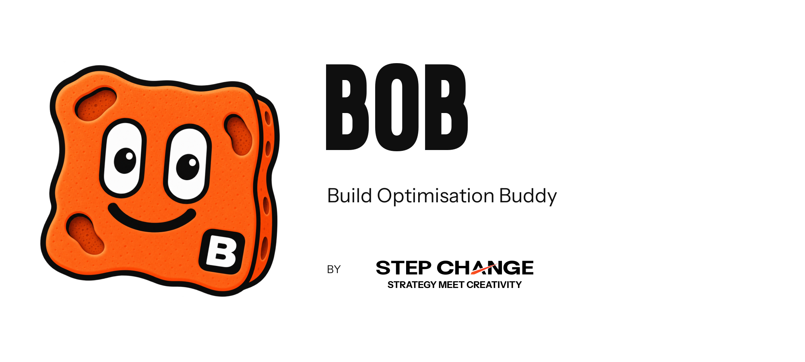

# BOB

BOB is a Claude Code plugin by Step Change that makes builds designed-first, gated and visible for people who have never used a terminal. It governs a repo through files under `bob/`: an approved brief, bounded increments, and evidence-backed verification, where no round can start unapproved and no round can end unproven.

- Install in a repo: `claude plugin install bob --marketplace ashton-netizen/bob --scope project` (engine 2.1.304 or later).
- Commands: `/bob` (status), `/bob open`, `/bob adopt`, `/bob approve <increment id>` (typed by a person).
- Start here: `CLAUDE.md`, then `docs/product/product-plan.md`, then `docs/project-status.md` and `docs/handoff.md`.

Brand: `assets/bob/` holds the approved BOB character, lockups and favicon set; `assets/step-change/` holds the real Step Change logo and font files, used unchanged. Context: `references/bob-brand/BRAND-AND-CONTEXT.md`. BOB serves no HTML today, so the favicon set waits for the first page BOB renders.
